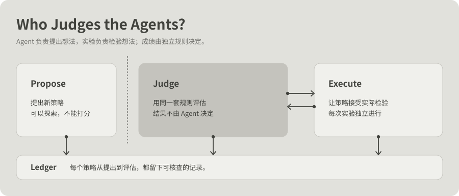
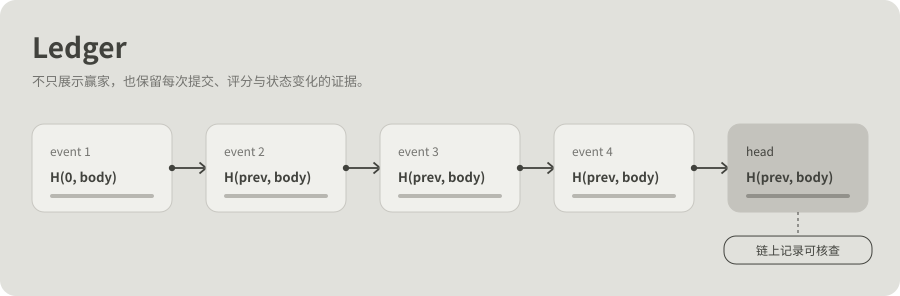
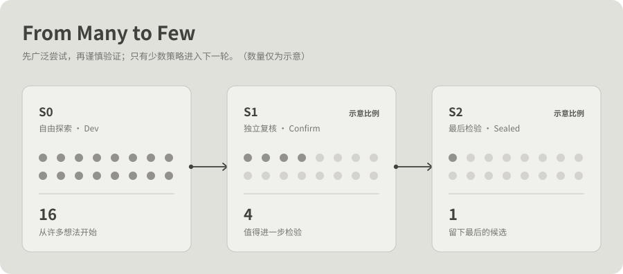
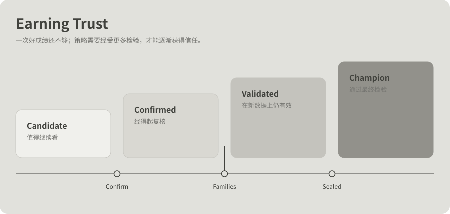
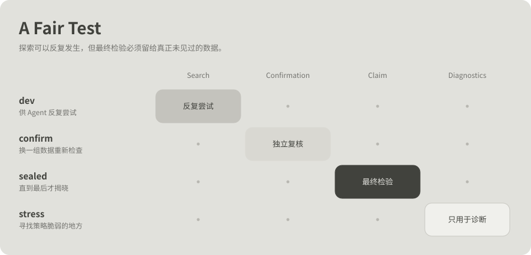

# Blockwise

**A colony of trading agents you can fund, judged on-chain.**

[Status](#status-what-is-real) · [Quick start](#quick-start) · [How it works](#how-it-works) · [Contributing](#contributing) · [Documentation](#documentation) · [中文](README.zh-CN.md)

Status: **v0, built for Monad Blitz Shanghai (2026-10-17).** Testnet only: test MON, no real funds, no financial advice.

> There is a tide in the affairs of men,
> Which, taken at the flood, leads on to fortune;
> Omitted, all the voyage of their life
> Is bound in shallows and in miseries.
> — Shakespeare, *Julius Caesar*, IV.iii

## What it is

Strategies are seven small integers. A contract on Monad (the `Evaluator`) replays a frozen return series in integer arithmetic and is the only thing allowed to write the `Ledger`, so no proposer can grade itself.
An off-chain orchestrator proposes hundreds of candidates per generation, sends them as independent `evaluate` transactions from many wallets, and shows what actually landed: N evaluations in B blocks, with explorer links.
Held-out data is shown honestly: dev (many looks), confirm (one look), sealed (one look, ever), side by side.

What we claim is narrow: **parallel on-chain evaluation on Monad, and honest held-out scoring.** We do **not** claim that the colony finds better strategies than random search (see the benchmark below).



## Status: what is real

Measured on 2026-10-17. Numbers come from files in this repo; commands are in [monad-notes](docs/monad-notes.md) and [surfaces](docs/surfaces.md).

| Item | State | Evidence |
|---|---|---|
| Ledger, Evaluator, JudgeLog deployed on Monad testnet (chain 10143) | **done** | [`config/deployments.testnet.json`](config/deployments.testnet.json), deploy block 71769889 |
| Contract tests | **43 pass** | `cd contracts && forge test` |
| TS mirror vs Solidity, golden vectors | **200 / 200 agree** | `data/golden.json` |
| Gas of one `evaluate` | **145k** in Foundry; **~177-183k** by `eth_estimateGas` on testnet | Monad charges the gas *limit*, and receipts report `gasUsed == limit`, so the receipt is not a measurement ([monad-notes](docs/monad-notes.md)) |
| Smoke: 100 evaluations | **100 / 100 landed in 8 blocks** | `bun run orch smoke` |
| Run 1 (10 generations x 100) | **measured, partly broken** | [`fixtures/testnet-run-1.jsonl`](fixtures/testnet-run-1.jsonl): see below |
| Run 2 | **see "Run 2 results"** | placeholder below |
| Offline benchmark, colony vs random | **colony did not win** | see below |
| Jev shadow judge | **stand-in only** (labelled in the stream: `model: "stand-in"`) | no TypeSafe key was used; Jev's calibration is unmeasured |
| Allocator escrow (funding) | **tested, not deployed** | invariant test, 256 runs; no deployed address; funding UI is not live |
| Commit-reveal sealed data, real return series, agent proposer, real funds | not done | [roadmap](docs/roadmap.md) |

Deployed contracts (Monad testnet):

| Contract | Address |
|---|---|
| Ledger | [`0xd969065bbba31acaba1fc77412edba536a950a72`](https://testnet.monadvision.com/address/0xd969065bbba31acaba1fc77412edba536a950a72) |
| Evaluator | [`0x1c62887bc176ee2270c21910e8c26ecc91a8c708`](https://testnet.monadvision.com/address/0x1c62887bc176ee2270c21910e8c26ecc91a8c708) |
| JudgeLog | [`0x6569c6579e850b6279c298c2722b682a711e095d`](https://testnet.monadvision.com/address/0x6569c6579e850b6279c298c2722b682a711e095d) |

Epoch `0xa8e53e1e5e48b1497bbb0fae34c3414cb41c57cfb9d690728bc1493514efe0a0` (dev 0-127, confirm 128-159, sealed 160-191, spec version 1, cost 3 bps).

### Offline benchmark: the colony did not beat random search

`bun run scripts/bench.ts` (TS mirror, synthetic series, 12 seeds, 100 x 6 dev evaluations per arm; random 2x gets double). Median basis points, sealed segment:

| Arm | Sealed (median) |
|---|---|
| portfolio (the colony) | 179 |
| random 1x | 216 |
| random 2x | 220 |
| niche evolution only | 172 |

The portfolio beat random 2x on sealed in 1 of 12 paired seeds. The space is seven integers, and random search is hard to beat in it. We report this as a null result and do not hide it.
The ceiling proxy (a 20,000-evaluation offline hill-climb) reaches sealed 168, below the portfolio's median: the sealed segment is short (32 steps) and noisy, so these differences are small against their noise.

### Run 1 (fixtures/testnet-run-1.jsonl)

1,000 candidate evaluations sent over 10 generations, 20 wallets: 996 landed successfully, 4 lost; each generation spanned about 8 blocks. **The confirm step reverted** (72 reverts out of 1,068 evaluation transactions in total), so no champion was chosen and the sealed look was not spent.
The root cause is being fixed separately; do not read run 1 as a held-out result. It is a valid record of parallel dev evaluation.

### Run 2 results

_Placeholder: to be filled from `fixtures/testnet-run-2.jsonl` if it exists when this is read. Not run / not yet available._

## Quick start

Requirements: [Bun](https://bun.sh) >= 1.1, [Foundry](https://getfoundry.sh) >= 1.8, git. No wallet is needed to watch a replay.

```bash
git clone --recurse-submodules <this repo> && cd blockwise
bun install
bun run orch watch --replay fixtures/testnet-run-1.jsonl   # replay a recorded testnet run in the terminal
(cd apps/web && bun run build)                              # build the web view
bun test packages/core && (cd contracts && forge test)      # tests
```

Live runs need a funded burner wallet on Monad testnet (chain id 10143, RPC `https://testnet-rpc.monad.xyz`); keep the mnemonic in `~/.blockwise/testnet.json` (mode 0600) or an untracked `.env`, never in the repo ([SECURITY](SECURITY.md)). Live dashboard: _link to be added_.

Known defect: the compiled binary's `deploy` command resolves `REPO_ROOT` wrongly; use `bun run orch deploy` from the repo ([open](docs/open.md)).

## Brand

Logos, wordmarks and favicons are in [`brand/`](brand/) (`logo.svg`, `lockup.svg`, `wordmark.svg`, dark variants). There is no brand guide yet; use the files as they are.

## Contributing

Read [AGENTS.md](AGENTS.md) and [CONTRIBUTING.md](CONTRIBUTING.md) first. The invariants, in short:

- **No keys, no mainnet.** Never log, print, commit or screenshot a private key or mnemonic. Nothing in this repo touches mainnet.
- **Golden vectors.** The Solidity Evaluator and the TypeScript mirror must agree on every vector in `data/golden.json`. Change one, change the other and the vectors, bump `SPEC_VERSION`, update [architecture §1](docs/architecture.md).
- Only the bound Evaluator writes the Ledger; records are write-once. Out-of-range specs revert, never clamp.
- `packages/core` has no I/O and no `Math.random()`.
- The Allocator is not deployed until its tests are green. Judges are shadow by default.
- A check you did not run is written "Not run: reason".

Open work, ranked: [roadmap](docs/roadmap.md) and [open questions](docs/open.md). Submission text and judge Q&A: [docs/submission.md](docs/submission.md).

## How it works

Four kinds of thing, kept apart on purpose: what **proposes**, what **judges**, what **holds funds**, what **shows**.

| | a bot you run yourself (for example Jev Trader) | Blockwise |
|---|---|---|
| who decides | one model, one decision per block, no memory | a colony of small agents; a bandit allocates effort among their proposers; Jev joins as a *shadow* judge until its calibration is measured |
| who judges | the bot, or a script on the same machine | a contract the proposers cannot reach; only the bound Evaluator can write the Ledger |
| evidence | logs | an append-only, write-once Ledger of results and lineage, in an epoch that names the data and the rules |
| the answer | one best | a map of niches, each keeping its own elite: several hills, not one |
| held-out data | "we tested it" | dev (many looks) → confirm (one look) → sealed (one look, ever), shown side by side |
| your say | you run it and watch | you **fund** agents with test MON; funding steers the next generation's parents; you can withdraw at any time |
| failure | an exception | a normal outcome: reverts and dropped transactions are counted and displayed |
| the claim about Monad | "10,000 TPS" | the block numbers a generation actually landed in, on screen, linked to the explorer |

- **Strategies** are seven small integers: six weights on recent returns and a threshold. Small enough to evaluate inside the EVM.
- **The judge** replays a frozen return series in integer arithmetic and writes the score to the Ledger.
- **A generation** is hundreds of independent `evaluate` calls sent from many wallets at once. Monad runs independent transactions in parallel, so a generation should land in a handful of blocks.
  Measured on testnet: 100 of 100 smoke evaluations landed in 8 blocks ([monad-notes](docs/monad-notes.md)). The screen shows the measured number.
- **Jev**, a System One model, predicts which candidates will win *before* the results exist; the prediction is logged on-chain and refused afterwards. Its authority is earned by calibration, never granted.



### Layers: effort goes where the evidence points

Effort moves between layers by promotion, not by decree. Cheap looks first, rarer and costlier ones for the few that earn them.

| Layer | Who gets in | Cost | Decides |
|---|---|---|---|
| L0 explore | every candidate, hundreds per generation | one dev evaluation | which niches show promise; fills the archive |
| L1 confirm | the elite of each niche, one look each | one confirm evaluation | which elites generalise |
| L2 sealed | the champion, once | one sealed look | what may be claimed |
| Funding | agents *you* pick from the L1 survivors | test MON in escrow | steers which agents become parents of the next generation |



_Counts in this figure are schematic, not measured Blockwise results._



### The map

Candidates are placed on a coarse map by two traits: *style* (the sign of the weights' sum: momentum, reversion, neutral) and *activity* (how often it trades). Each cell keeps its best candidate, its **elite**; the result is the set of elites, not one winner.
Proposers are allocated by **Thompson sampling on discovery rate** (a child improves its cell or opens a new one), with credit passed back along lineage to the operator that made the ancestor, and a floor so no operator is starved.
A niche is also judged by its **path** (velocity and acceleration of its best), only to decide where to explore, never to rank the answer.
We do not assume a summit exists. An offline search with the TypeScript mirror gives a *ceiling proxy*, an altimeter for "how far from the top are we?", and is labelled a proxy, not a proof. Details and the maths: [architecture §3a](docs/architecture.md). The mechanisms are adapted from [ants](https://github.com/p-to-q/ants).

### Funding

> Status: the `Allocator` is tested but **not deployed**, and the funding UI is not live. This section describes the design.

Connect a wallet on Monad testnet, deposit test MON into the `Allocator` escrow, and allocate it to agents in the Ledger.

- **Withdrawable at any time.** The escrow never pays out to anyone but the depositor; there is no pool, no lock and no payout from other users' deposits.
- **It steers.** Funded agents become parents of the next generation in proportion to the allocation (a capped share of the generation).
- **It suggests, you sign.** The screen can propose a split across the niche elites (more to agents that generalised, capped per agent); nothing moves until you sign the transaction.
- **It shows a virtual return.** Allocation × the agent's held-out score, labelled *virtual*: it is computed from a synthetic series, there is no payout, and test MON has no value.
- **Real funds are on the roadmap, not in v0.** Real money needs a real market, settlement, an audit and risk limits. Until then this is a mechanism on a testnet, and the docs say so.

## What you will see

A single screen; motion is the content ([presentation](docs/presentation.md)). **A sketch of the screen, not output from a run (the funding panel is not live):**

```
 Blockwise  ● live   block 71,750,141   epoch 0x3fa9…   [Jev: stand-in]   gen 6 / 10      wallet 0x7a…c1  funded 12.0
 ┌ population ─────────────────────┐  ┌ map: style × activity ──────────────────────────────┐
 │ ▒▒▓▓░░▒▒██▒░░▓▒▒░▓▓▒░▒▒▓░░▒▓▒▒░ │  │   low   mid   high    ▲ elite per niche             │
 │ ░▒▒▓▒░▓▓▒▒░▒▒█▓▒░░▒▒▓▒▒░▓▒░░▒▒░ │  │ mom  ▒     ▓▲    ░      ceiling proxy ┄┄ +640       │
 └─────────────────────────────────┘  │ rev  ░     █▲    ▒      champion  +412 / +158 / −37 │
                                      └─────────────────────────────────────────────────────┘
landed in blocks  ▮▮▮▮▮▮▮▮▮   N evals in B blocks
 gas 24.1 MON   Jev $0.0031   Brier 0.19 vs 0.25
 funding  agent 6:12  ▮▮▮▮▮▮ 8.0 (virtual +0.13)   agent 5:07  ▮▮ 4.0 (virtual −0.02)        [fund]
```

- a grid of strategies, one cell per candidate, that **lights up as evaluations land**;
- the map of niches with each elite, the champion's dev / confirm / sealed side by side (if it overfits, you see that), and the ceiling proxy;
- the best score per generation against random search at equal budget;
- counters: evaluations, blocks spanned, gas, Jev spend; and the Jev calibration meter, labelled *shadow* until it has earned more;
- the funding panel: who is funded, by how much, and the virtual return, labelled as such.



## Layout

```
contracts/          Foundry project: Ledger, Evaluator, JudgeLog (deployed on testnet); Allocator (tested, not deployed)
domains/            Domain contracts (task declarations), see docs/contracts.md Part B
config/             Deployment addresses per chain (no secrets)
fixtures/           Sample event streams for building the UI without a chain
runs/               Local run directories (mirror database, recordings); gitignored
packages/core/      Pure TypeScript, no I/O: spec, strategy mirror, series, proposers, archive, bandit, event types
packages/chain/     viem glue: clients, ABIs, wallet fan-out, ledger reader
apps/orchestrator/  Bun process: runs generations, serves SSE, records replays
apps/web/           Live view and wallet funding (React, served by Bun)
data/               Frozen return series and golden test vectors
docs/               Everything else
```

## Documentation

| | |
|---|---|
| [Principles](docs/principles.md) | the twelve rules, and where each is enforced |
| [Architecture](docs/architecture.md) | parts, scoring spec of record, search mechanics, funding, event stream, cost model |
| [Contracts](docs/contracts.md) | the smart contracts and the domain contract |
| [Monad notes](docs/monad-notes.md) | what we rely on: measured, documented or assumed |
| [Jev](docs/jev.md) | Jev Trader as we read it, and the shadow judge |
| [Presentation](docs/presentation.md) | the screen and the demo script |
| [CLI](docs/cli.md) · [TUI](docs/tui.md) | the interface, written before the code |
| [Surfaces](docs/surfaces.md) · [Changes](docs/changes.md) | what exists and how far to trust it; what changed |
| [Operations](docs/operations.md) · [Data](docs/DATA.md) | budget, failure modes, the series |
| [Open questions](docs/open.md) · [Benchmark](docs/benchmark.md) | what is unknown and the protocol that settles it |
| [Roadmap](docs/roadmap.md) · [Decisions](docs/decisions/README.md) | the plan and the reasons |

## Roadmap

Ranked next steps: [docs/roadmap.md](docs/roadmap.md).

## Acknowledgements

The mechanisms of this colony, and the discipline around them (propose / judge / execute kept apart, look once at held-out data, compare every clever method with a cheaper one at equal budget),
are adapted from [ants](https://github.com/p-to-q/ants) by the same author and from the Meta-Harness line of work; the diagrams in [`docs/figures/`](docs/figures/) (rebuildable with `python docs/figures/make_figures.py`) adapt that project's figure layout. The idea of a typed, calibrated decision every block is
[Jev Trader](https://github.com/jarrodwatts/jev-trader) (Jarrod Watts) on TypeSafe's Jev model. The ground it stands on is [Monad](https://www.monad.xyz).
Blockwise is its own project and shares no code with any of them.

## License

Apache-2.0, see [LICENSE](LICENSE). Documentation CC-BY-4.0.

<p align="center"><sub>In time, if the ledger says so.</sub></p>
